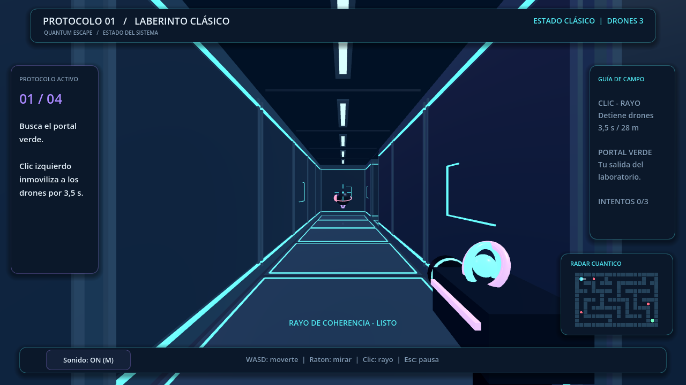

# Quantum Escape 3D

Un laboratorio cuántico para explorar en primera persona con teclado y ratón. Congela drones con tu rayo, atraviesa muros en superposición y conecta dos qubits para entregar colores.

**[Abrir la demo web](https://oscarlopcamp.github.io/Quantum-Escape/)**

La demostración funciona en el navegador, sin base de datos y sin instalar Godot.

## Empieza a jugar

El menú ofrece **Iniciar juego**, **Tutorial corto** y **Salir**. Puedes entrar directamente al primer nivel o practicar cuatro acciones en un entrenamiento opcional: moverte, mirar, congelar un dron y usar superposición para llegar al portal. El entrenamiento no tiene castigos ni límite de tiempo.

| Acción | Control |
| --- | --- |
| Moverte / elegir opciones | WASD o flechas |
| Mirar y apuntar | Ratón |
| Disparar | Clic izquierdo |
| Superposición / cambiar de qubit | Espacio |
| Confirmar | Enter o clic |
| Reiniciar después de fallar | R |
| Silenciar o activar sonido | M |
| Pausar | Esc |

Al cambiar de pestaña o perder el foco, la partida se pausa. **Enter** o clic en **Continuar** captura de nuevo el ratón; **Esc** desde la pausa vuelve al menú.

## Cuatro desafíos cuánticos

1. **Laberinto clásico:** alcanza el portal verde y evita a los drones.
2. **Superposición:** cambia de estado para atravesar los muros.
3. **Medición:** evita los escáneres M mientras estás en superposición.
4. **Entrelazamiento:** enlaza Q1 y Q2 en las estaciones E y completa tres entregas de colores.

El rayo inmoviliza drones durante **3,5 segundos**. Los circuitos de neón, la paleta cian/violeta, el qubit animado y la música electrónica acompañan el recorrido.

[Ver el menú](QuantumEscape_Godot_FIX22/previews/menu.png) · [Ver el tutorial](QuantumEscape_Godot_FIX22/previews/tutorial.png) · [Ver entrelazamiento](QuantumEscape_Godot_FIX22/previews/entrelazamiento.png)

## Abrir o exportar el proyecto

Abre [project.godot](QuantumEscape_Godot_FIX22/project.godot) con Godot 4.7 y pulsa **Ejecutar proyecto** o **F5**.

La exportación web utiliza **Compatibility**, con threads desactivados. El preset **Web** escribe en `docs/index.html`; los detalles están en el [README del proyecto](QuantumEscape_Godot_FIX22/README.md).

Si aparece una versión antigua o un aviso de configuración que se repite, recarga con **Ctrl+Shift+R** en PC o **Cmd+Shift+R** en Mac. Si persiste, borra los datos del sitio y vuelve a abrir la demo. Recargar reinicia la partida.
